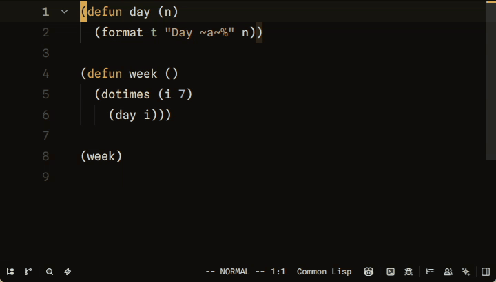

# Parinfer for Zed

[Parinfer] extension for [Zed].

Based on [parinfer-rust].

[Parinfer]: https://shaunlebron.github.io/parinfer/
[Zed]: https://zed.dev/
[parinfer-rust]: https://github.com/eraserhd/parinfer-rust

## What is Parinfer?

To quote [Parinfer website]:

> **Parinfer** is a proof-of-concept editor mode for Lisp programming languages. It simplifies the way we write Lisp by auto-adjusting parens when indentation changes and vice versa. The hope is to make basic Lisp-editing easier for newcomers and experts alike, while still allowing existing plugins like Paredit to satisfy the need for more advanced operations.

[Parinfer website]: https://shaunlebron.github.io/parinfer/

## Thanks

- [Shaun Lebron](https://github.com/shaunlebron), for inventing Parinfer.
- [Jason Felice](https://github.com/eraserhd) and everyone behind
  parinfer-rust, which does the actual work here.
- [parinfer-rust-mode](https://github.com/justinbarclay/parinfer-rust-mode),
  whose tests showed us what to test.

## License

MIT. Parinfer's test cases in `server/tests/cases/` keep their own licences,
ISC and MIT.
